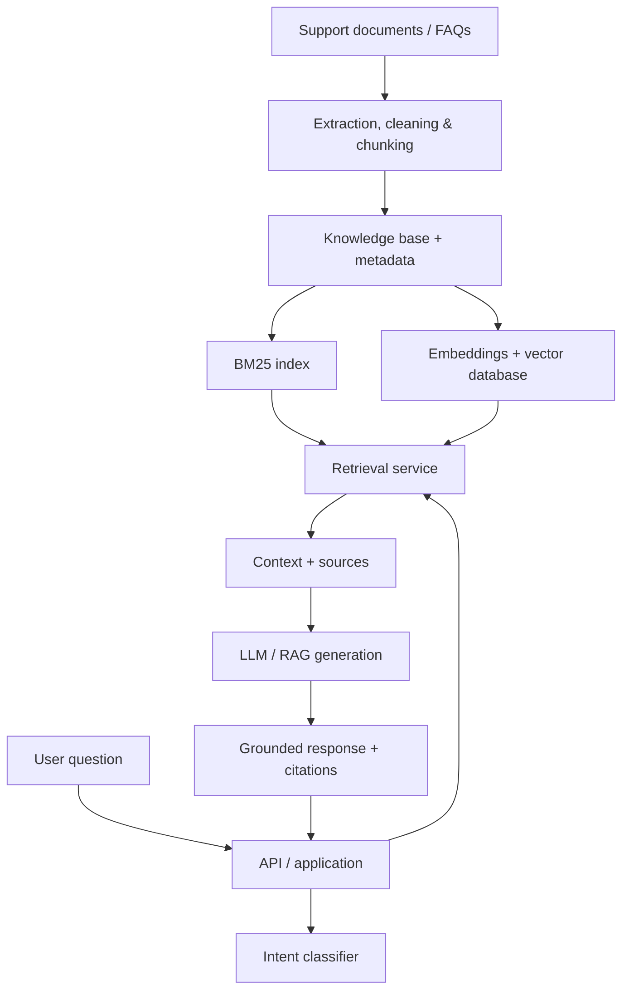

<div align="center">

# 🤖 SupportAI

### Intelligent Customer Support Powered by NLP, Semantic Search & RAG

**An end-to-end Data Science and AI Engineering project** that explores how natural language processing, machine learning, information retrieval, and large language models can work together to deliver reliable, context-aware customer support.

[](https://www.python.org/)
[](https://fastapi.tiangolo.com/)
[](https://nextjs.org/)
[](https://www.trychroma.com/)
[](#project-status)

[Overview](#overview) · [Architecture](#planned-architecture) · [Modules](#core-modules) · [Getting Started](#getting-started) · [Contributing](#collaboration-workflow)

</div>

---

## Overview

SupportAI is a collaborative academic project designed to build and evaluate an **AI-powered customer support assistant**. Instead of relying only on an LLM's general knowledge, the system aims to retrieve relevant information from a curated support knowledge base before generating an answer.

The project also explores **intent classification**, **lexical versus semantic retrieval**, and **RAG evaluation**, with a focus on grounded responses, source citations, and measurable performance.

> **Project status:** Initial repository structure is ready. The modules and integrations described below are the **planned implementation**, not completed functionality.

## Project Goals

- Prepare and process a reusable customer-support knowledge base.
- Train and compare machine-learning models for support-intent classification.
- Implement **BM25** and **embedding-based semantic search**.
- Index document chunks in a vector database such as **ChromaDB**.
- Build a **Retrieval-Augmented Generation (RAG)** pipeline with source attribution.
- Evaluate retrieval relevance, classification quality, answer correctness, and groundedness.
- Integrate the AI modules into a web application with an API backend.
- Package the system for reproducible local development and demonstration.

## Planned Architecture



*Architecture is a target design and may evolve during implementation.*

## Core Modules

| Module | Scope | Directory |
|---|---|---|
| Data Engineering | Ingestion, cleaning, annotation, chunking | `data/`, `scripts/` |
| NLP & Machine Learning | Intent classification and model evaluation | `ml/nlp/` |
| Retrieval & Vector Database | BM25, embeddings, ChromaDB, retrieval metrics | `ml/retrieval/` |
| RAG & LLM Evaluation | Prompting, generation, citations, hallucination analysis | `ml/rag/` |
| Full-Stack & MLOps | API, interface, integration, local deployment | `backend/`, `frontend/` |
| Testing & Research | Experiments, test suites, technical documentation | `experiments/`, `tests/`, `docs/` |

## Repository Structure

```text
Projet-Data-Science-SupportAI/
├── backend/
│   ├── api/
│   ├── schemas/
│   └── services/
├── data/
│   ├── raw/
│   └── processed/
├── docs/
├── experiments/
├── frontend/
├── ml/
│   ├── nlp/
│   ├── rag/
│   └── retrieval/
├── scripts/
├── tests/
└── .gitignore
```

## Technology Stack (Planned)

| Layer | Candidate technologies |
|---|---|
| Data processing | Python, pandas, document extraction tools |
| NLP / ML | scikit-learn, sentence-transformers |
| Retrieval | BM25, dense embeddings, ChromaDB |
| RAG | LLM API or local model, prompt orchestration |
| Backend | FastAPI, Pydantic |
| Frontend | Next.js / React |
| Deployment | Docker, Docker Compose |
| Collaboration | Git, GitHub Pull Requests, ClickUp |

*Specific providers, libraries, and versions will be confirmed as the team builds and benchmarks the system.*

## Getting Started

### Prerequisites

- Git
- Python (target: 3.11 or newer)
- Node.js (when frontend development begins)
- Docker (when containerized services are introduced)

### Clone the repository

```bash
git clone https://github.com/Houcineaberhache/Projet-Data-Science-SupportAI.git
cd Projet-Data-Science-SupportAI
```

The repository currently contains the initial directory structure. **There is no runnable application yet.** Module-specific installation and execution commands will be added as each component is implemented.

### Configuration

Never commit real credentials, customer records, or local vector database indexes. When an `.env.example` file is added, copy it to `.env` and set the required variables locally.

## Collaboration Workflow

This project is developed by a team of five contributors. Each task should be implemented in its own short-lived feature branch.

```bash
# Start from the latest main
git switch main
git pull origin main

# Create a branch for one task
git switch -c feature/retrieval-bm25

# Commit and publish your work
git add .
git commit -m "feat(retrieval): add BM25 baseline"
git push -u origin feature/retrieval-bm25
```

Then open a **Pull Request targeting `main`**, describe the changes and tests, request a teammate's review, and merge after approval. Avoid direct pushes to `main`.

**Suggested commit prefixes:** `feat`, `fix`, `docs`, `test`, `refactor`, `chore`.

## Team Responsibilities

| Role | Primary responsibility |
|---|---|
| Project Manager + Retrieval Engineer | Planning, coordination, BM25, embeddings, vector search |
| Data Engineer | Data collection, preprocessing, annotation |
| NLP & ML Engineer | Intent models and classification evaluation |
| RAG & LLM Engineer | Grounded generation, citations, RAG evaluation |
| Full-Stack & MLOps Engineer | API, user interface, integration, deployment |

All contributors participate in testing, documentation, and final delivery.

## Evaluation Plan

The project intends to compare components using relevant metrics:

- **Intent classification:** accuracy, macro-F1, confusion matrix.
- **Retrieval:** Precision@K, Recall@K, MRR and qualitative relevance checks.
- **RAG:** answer correctness, faithfulness/groundedness, citation quality, and abstention behavior.
- **Application:** integration tests, error handling, and basic performance checks.

Results will be documented in `experiments/` and `docs/` once available.

## Project Status

- [x] Repository created and shared with the team
- [x] Initial monorepo folders created
- [ ] Data ingestion and preprocessing pipeline
- [ ] NLP classification baselines
- [ ] BM25 and vector retrieval
- [ ] RAG pipeline and citations
- [ ] Frontend and backend integration
- [ ] Evaluation and automated tests
- [ ] Reproducible local deployment
- [ ] Final report and demonstration

## Responsible Use

SupportAI is an educational prototype. Generated responses should be grounded in approved documents and should not be treated as inherently correct. The team will evaluate unsupported claims and implement appropriate fallback behavior. Only appropriately licensed or authorized datasets should be included in experiments.

---

<div align="center">

**Built collaboratively by a five-member Data Science & AI Engineering team.**

*From documents to evidence-backed answers.*

</div>
