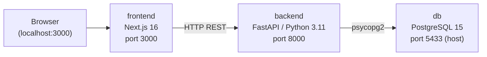

# SupportAI – DevOps Guide

## Architecture



All three services run in the `supportai_network` bridge network and are
orchestrated by Docker Compose.  
The host exposes **:3000** (UI), **:8000** (API), and **:5433** (DB, dev only).

---

## Run Locally with Docker

### Prerequisites

- Docker ≥ 24 and Docker Compose v2
- No local Python or Node required

### Steps

```bash
# 1 — Clone and enter the repo
git clone https://github.com/Houcineaberhache/Projet-Data-Science-SupportAI.git
cd Projet-Data-Science-SupportAI

# 2 — Create your local env file (never committed)
cp .env.example .env
# edit .env if you need non-default credentials

# 3 — Build and start
docker compose up -d --build

# 4 — Verify all services are healthy
docker compose ps
```

| URL | Purpose |
|---|---|
| http://localhost:3000 | Chat UI |
| http://localhost:3000/admin | Admin dashboard |
| http://localhost:8000/health | Backend health |
| http://localhost:8000/docs | FastAPI Swagger UI |
| localhost:5433 | PostgreSQL (dev access) |

### Stop / teardown

```bash
docker compose down          # stop and remove containers, keep volumes
docker compose down -v       # also delete the postgres data volume
```

---

## Environment Variables

All variables have sensible defaults so the stack works out of the box.
Copy `.env.example` to `.env` to override any value locally.

| Variable | Default | Used by | Description |
|---|---|---|---|
| `POSTGRES_USER` | `postgres` | db, backend | PostgreSQL superuser name |
| `POSTGRES_PASSWORD` | `postgres` | db, backend | PostgreSQL password |
| `POSTGRES_DB` | `supportai_db` | db, backend | Database name |
| `POSTGRES_PORT` | `5433` | db | Host-side port for the DB |
| `DATABASE_URL` | `postgresql://postgres:postgres@db:5432/supportai_db` | backend | Full DSN used by FastAPI |
| `BACKEND_PORT` | `8000` | backend | Host-side port for the API |
| `FRONTEND_PORT` | `3000` | frontend | Host-side port for the UI |
| `NEXT_PUBLIC_API_URL` | `http://localhost:8000` | frontend | API base URL in the browser |

> [!CAUTION]
> Never commit `.env`. It is excluded by `.gitignore`. Only commit `.env.example` with placeholder values.

---

## Healthchecks

Each service has a Docker-native healthcheck. Compose enforces the startup order:
`db` → `backend` → `frontend` (each waits for the previous to become healthy).

| Service | Mechanism | Interval | Retries |
|---|---|---|---|
| **db** | `pg_isready -U postgres -d supportai_db` | 5 s | 10 |
| **backend** | `GET /health` returns `{"status":"ok","database":"connected"}` | 10 s | 5 |
| **frontend** | `wget -qO- http://127.0.0.1:3000/` | 10 s | 5 |

Check live status:

```bash
docker compose ps                        # STATUS column shows (healthy)
docker inspect --format '{{.Name}}: {{.State.Health.Status}}' \
    supportai_postgres supportai_backend supportai_frontend
```

The `/health` endpoint also validates the DB connection. A `503` response means
the backend started but cannot reach PostgreSQL.

---

## Troubleshooting

### A container stays `unhealthy`

```bash
docker compose logs <service>   # e.g. docker compose logs backend
```

Common causes:
- **db**: port 5433 already in use on the host — change `POSTGRES_PORT` in `.env`.
- **backend**: DB not ready yet, or wrong `DATABASE_URL` — check that `POSTGRES_*` values match.
- **frontend**: slow build on first start — `start_period` is 15 s; wait and re-check.

### Rebuilding after a code change

```bash
docker compose up -d --build backend   # rebuild one service
docker compose up -d --build           # rebuild all
```

### Resetting the database

```bash
docker compose down -v                 # removes the pgdata volume
docker compose up -d                   # re-runs init.sql on fresh start
```

### Inspect the running backend user

```bash
docker exec supportai_backend whoami   # should print: appuser
docker exec supportai_frontend whoami  # should print: nextjs
```
