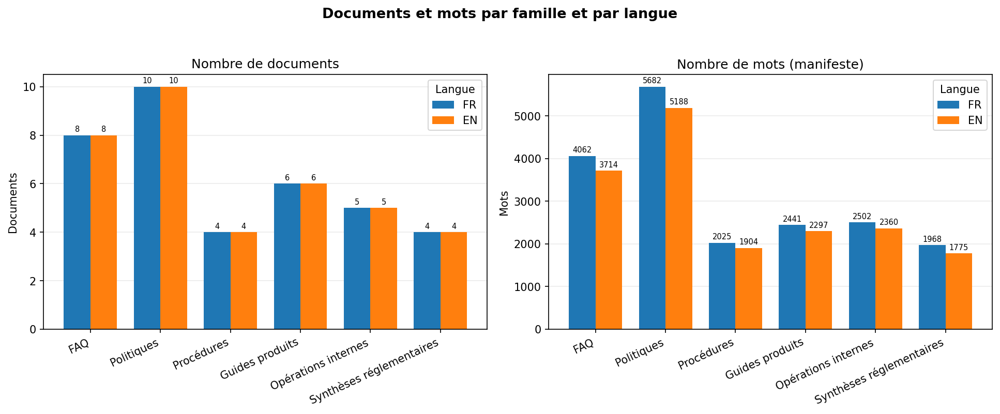
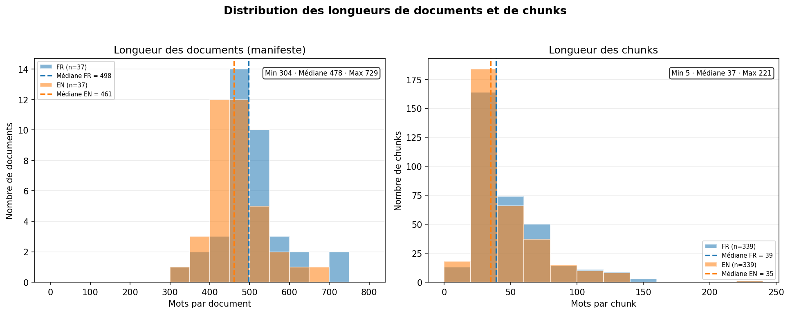
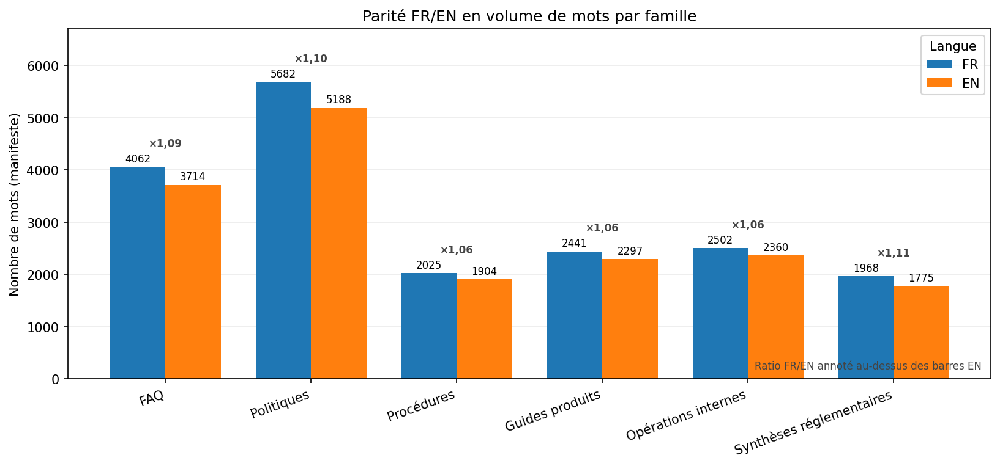
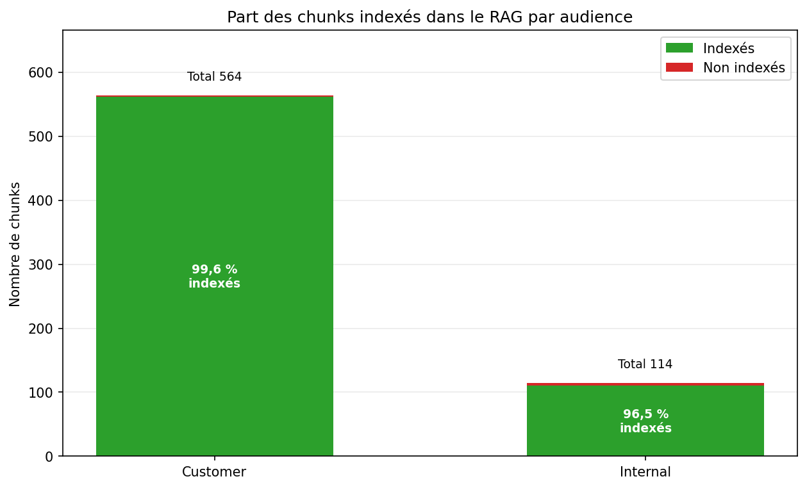
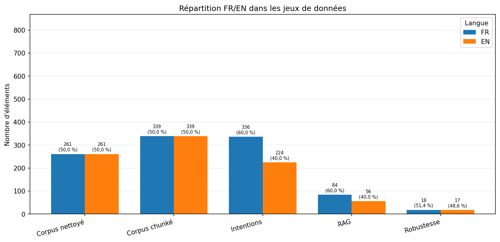
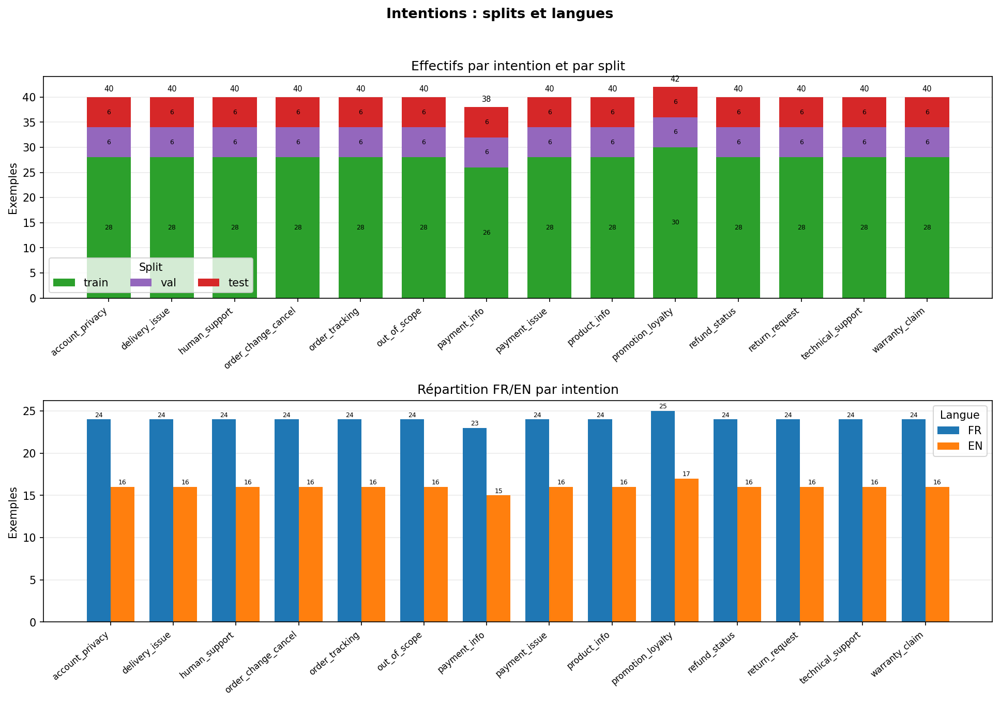
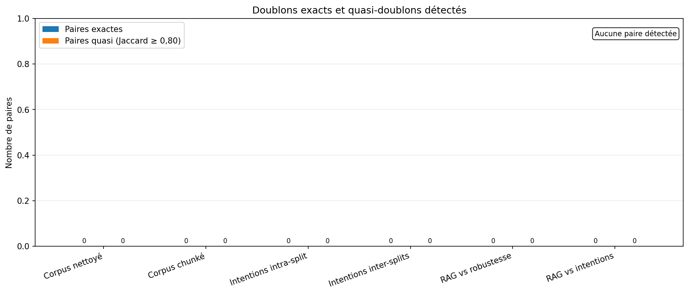
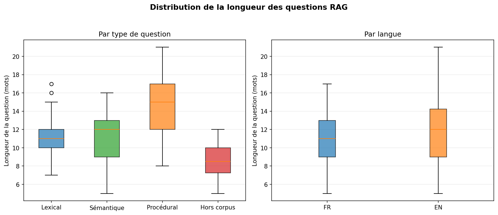
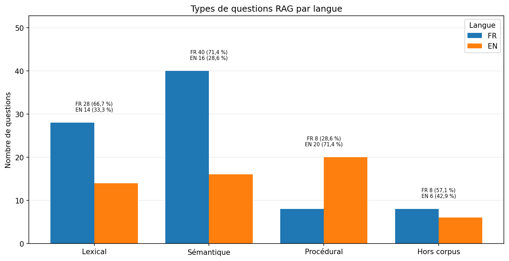
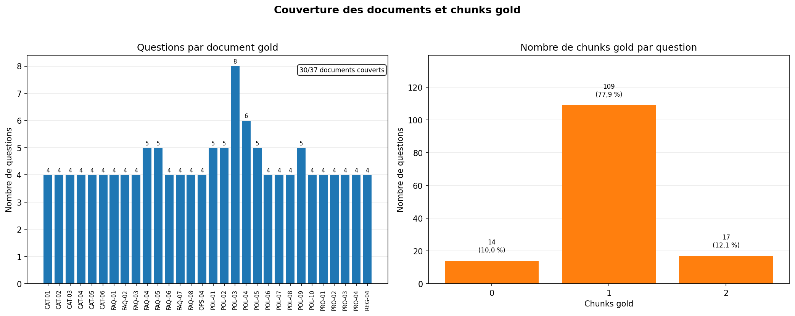

# Analyse exploratoire des données — SupportAI

> Fichier généré par `python scripts/run_eda.py`. Aucun horodatage, aucun chemin absolu.

## Périmètre

L'analyse porte uniquement sur les fichiers publics listés ci-dessous. `data/annotations/_private/` n'est ni lu ni utilisé.

- `data/processed/cleaned_corpus.jsonl`
- `data/processed/chunked_corpus.jsonl`
- `data/annotations/intent_dataset.jsonl`
- `data/annotations/rag_eval.jsonl`
- `data/annotations/robustness_eval.jsonl`
- `data/source_manifest.csv`

## Reproductibilité

```bash
python scripts/run_eda.py
python tests/test_eda.py
```

Graine fixe : `42`. Les clés de `docs/reports/eda_metrics.json` sont triées et le fichier ne contient pas d'horodatage. Les figures sont écrites dans `docs/figures/eda/`.

## 1. Documents et chunks









**Tableau 1.1 — Documents et mots par famille et par langue**

| Famille | Docs FR | Docs EN | Mots FR | Mots EN | Ratio mots FR/EN |
| --- | ---: | ---: | ---: | ---: | ---: |
| FAQ | 8 | 8 | 4 062 | 3 714 | 1,09 |
| Politiques | 10 | 10 | 5 682 | 5 188 | 1,10 |
| Procédures | 4 | 4 | 2 025 | 1 904 | 1,06 |
| Guides produits | 6 | 6 | 2 441 | 2 297 | 1,06 |
| Opérations internes | 5 | 5 | 2 502 | 2 360 | 1,06 |
| Synthèses réglementaires | 4 | 4 | 1 968 | 1 775 | 1,11 |
| **Total** | 37 | 37 | 18 680 | 17 238 | 1,08 |

**Tableau 1.2 — Longueur des documents et des chunks (en mots)**

| Périmètre | n | Min | Médiane | Max | Moyenne |
| --- | ---: | ---: | ---: | ---: | ---: |
| Documents (manifeste) | 74 | 304 | 478 | 729 | 485,38 |
| — FR | 37 | 328 | 498 | 729 | 504,86 |
| — EN | 37 | 304 | 461 | 656 | 465,89 |
| Chunks | 678 | 5 | 37 | 221 | 46,4 |
| — FR | 339 | 5 | 39 | 221 | 48,31 |
| — EN | 339 | 5 | 35 | 221 | 44,49 |

**Tableau 1.3 — Indexation des chunks dans le RAG par audience**

| Audience | Chunks | Indexés | Non indexés | Part indexée |
| --- | ---: | ---: | ---: | ---: |
| Customer | 564 | 562 | 2 | 99,6 % |
| Internal | 114 | 110 | 4 | 96,5 % |
| **Total** | 678 | 672 | 6 | 99,1 % |

## 2. Langues



**Tableau 2.1 — Répartition FR/EN dans les jeux**

| Jeu | Total | FR | EN | Part FR | Part EN |
| --- | ---: | ---: | ---: | ---: | ---: |
| Corpus nettoyé | 522 | 261 | 261 | 50,0 % | 50,0 % |
| Corpus chunké | 678 | 339 | 339 | 50,0 % | 50,0 % |
| Manifeste (documents) | 74 | 37 | 37 | 50,0 % | 50,0 % |
| Intentions | 560 | 336 | 224 | 60,0 % | 40,0 % |
| RAG | 140 | 84 | 56 | 60,0 % | 40,0 % |
| Robustesse | 35 | 18 | 17 | 51,4 % | 48,6 % |

**Tableau 2.2 — Cas de robustesse par catégorie et par langue**

| Catégorie de robustesse | FR | EN | Total |
| --- | ---: | ---: | ---: |
| ambiguous | 3 | 3 | 6 |
| explicit_answer | 5 | 5 | 10 |
| human_handoff | 3 | 2 | 5 |
| no_answer | 4 | 4 | 8 |
| rephrasing | 3 | 3 | 6 |

## 3. Intentions



**Tableau 3.1 — Effectifs par intention, split et langue**

| Intention | Train | Val | Test | Total | FR | EN |
| --- | ---: | ---: | ---: | ---: | ---: | ---: |
| account_privacy | 28 | 6 | 6 | 40 | 24 | 16 |
| delivery_issue | 28 | 6 | 6 | 40 | 24 | 16 |
| human_support | 28 | 6 | 6 | 40 | 24 | 16 |
| order_change_cancel | 28 | 6 | 6 | 40 | 24 | 16 |
| order_tracking | 28 | 6 | 6 | 40 | 24 | 16 |
| out_of_scope | 28 | 6 | 6 | 40 | 24 | 16 |
| payment_info | 26 | 6 | 6 | 38 | 23 | 15 |
| payment_issue | 28 | 6 | 6 | 40 | 24 | 16 |
| product_info | 28 | 6 | 6 | 40 | 24 | 16 |
| promotion_loyalty | 30 | 6 | 6 | 42 | 25 | 17 |
| refund_status | 28 | 6 | 6 | 40 | 24 | 16 |
| return_request | 28 | 6 | 6 | 40 | 24 | 16 |
| technical_support | 28 | 6 | 6 | 40 | 24 | 16 |
| warranty_claim | 28 | 6 | 6 | 40 | 24 | 16 |
| **Total** | 392 | 84 | 84 | 560 | 336 | 224 |

**Tableau 3.2 — Équilibre par split**

| Split | Total | Classe min | Classe max | Ratio max/min | Majoritaire |
| --- | ---: | ---: | ---: | ---: | ---: |
| train | 392 | 26 | 30 | 1,15 | promotion_loyalty |
| val | 84 | 6 | 6 | 1,00 | ex æquo (14 classes à 6) |
| test | 84 | 6 | 6 | 1,00 | ex æquo (14 classes à 6) |

**Tableau 3.3 — Exemples ambigus**

| ID | Intention | Split | Langue | Étiquettes acceptables |
| --- | ---: | ---: | ---: | ---: |
| INT-0321 | promotion_loyalty | train | fr | payment_info, promotion_loyalty |
| INT-0325 | promotion_loyalty | train | en | payment_info, promotion_loyalty |

## 4. Doublons



Les textes sont normalisés (minuscules, accents retirés, ponctuation réduite) et comparés par Jaccard sur les trigrammes de mots. Le seuil de quasi-doublon est `0,80`.

**Tableau 4.1 — Synthèse des doublons**

| Périmètre | Groupes exacts | Paires exactes | Paires quasi |
| --- | ---: | ---: | ---: |
| Corpus nettoyé | 0 | 0 | 0 |
| Corpus chunké | 0 | 0 | 0 |
| Intentions — intra train | 0 | 0 | 0 |
| Intentions — intra val | 0 | 0 | 0 |
| Intentions — intra test | 0 | 0 | 0 |
| Intentions — entre splits | — | 0 | 0 |
| RAG vs robustesse | — | 0 | 0 |
| RAG vs intentions | — | 0 | 0 |

**Tableau 4.2 — Paires détectées**

Aucune paire exacte ou quasi-doublon (Jaccard trigrammes ≥ 0,80) détectée.

## 5. Questions







**Tableau 5.1 — Types de questions par langue**

| Type | FR | EN | Total | Part FR | Part EN |
| --- | ---: | ---: | ---: | ---: | ---: |
| Lexical | 28 | 14 | 42 | 66,7 % | 33,3 % |
| Sémantique | 40 | 16 | 56 | 71,4 % | 28,6 % |
| Procédural | 8 | 20 | 28 | 28,6 % | 71,4 % |
| Hors corpus | 8 | 6 | 14 | 57,1 % | 42,9 % |
| **Total** | 84 | 56 | 140 | 60,0 % | 40,0 % |

**Tableau 5.2 — Longueur des questions en mots, par type et par langue**

| Type | Langue | n | Min | Médiane | Max | Moyenne |
| --- | ---: | ---: | ---: | ---: | ---: | ---: |
| Lexical | FR | 28 | 9 | 11 | 17 | 11,43 |
| Lexical | EN | 14 | 7 | 10 | 13 | 10,29 |
| Sémantique | FR | 40 | 5 | 12 | 16 | 11,72 |
| Sémantique | EN | 16 | 5 | 9 | 13 | 9,44 |
| Procédural | FR | 8 | 8 | 9,5 | 16 | 10,38 |
| Procédural | EN | 20 | 10 | 16 | 21 | 15,8 |
| Hors corpus | FR | 8 | 5 | 7,5 | 10 | 7,5 |
| Hors corpus | EN | 6 | 8 | 9,5 | 12 | 9,67 |
| **Total** | FR | 84 | 5 | 11 | 17 | 11,1 |
| **Total** | EN | 56 | 5 | 12 | 21 | 11,95 |

**Tableau 5.3 — Nombre de chunks et de documents gold par question**

| Nombre de gold | Questions (chunks) | Part | Questions (docs) | Part |
| --- | ---: | ---: | ---: | ---: |
| 0 | 14 | 10,0 % | 14 | 10,0 % |
| 1 | 109 | 77,9 % | 120 | 85,7 % |
| 2 | 17 | 12,1 % | 6 | 4,3 % |

**Tableau 5.4 — Couverture par document gold**

| Document gold | Questions |
| --- | ---: |
| CAT-01 | 4 |
| CAT-02 | 4 |
| CAT-03 | 4 |
| CAT-04 | 4 |
| CAT-05 | 4 |
| CAT-06 | 4 |
| FAQ-01 | 4 |
| FAQ-02 | 4 |
| FAQ-03 | 4 |
| FAQ-04 | 5 |
| FAQ-05 | 5 |
| FAQ-06 | 4 |
| FAQ-07 | 4 |
| FAQ-08 | 4 |
| OPS-04 | 4 |
| POL-01 | 5 |
| POL-02 | 5 |
| POL-03 | 8 |
| POL-04 | 6 |
| POL-05 | 5 |
| POL-06 | 4 |
| POL-07 | 4 |
| POL-08 | 4 |
| POL-09 | 5 |
| POL-10 | 4 |
| PRO-01 | 4 |
| PRO-02 | 4 |
| PRO-03 | 4 |
| PRO-04 | 4 |
| REG-04 | 4 |

## 6. Constats

1. Le corpus nettoyé contient 522 sections (261 FR, 261 EN) et le corpus chunké 678 chunks (339 FR, 339 EN) : la parité en nombre d'unités est exacte.
2. Le manifeste décrit 74 fichiers de connaissance (37 FR, 37 EN) pour 35 918 mots ; les documents FR totalisent 18 680 mots contre 17 238 en EN (ratio 1,08), donc la parité en mots n'est pas parfaite.
3. Les familles sont déséquilibrées : 10 politiques et 8 FAQ par langue, contre 4 procédures et 4 synthèses réglementaires par langue.
4. La longueur médiane d'un document est de 478 mots (min 304, max 729) ; celle d'un chunk est de 37 mots (min 5, max 221).
5. 672 chunks sur 678 (99,1 %) sont indexés dans le RAG ; la part est de 99,6 % pour l'audience customer (562/564) et 96,5 % pour l'audience internal (110/114). Les 6 chunks exclus sont marqués too_short.
6. Le jeu d'intentions contient 560 exemples : 392 train, 84 val, 84 test. La classe majoritaire est promotion_loyalty (42), la minoritaire payment_info (38), soit un ratio max/min de 1,11.
7. Les val/test sont équilibrés à 6 exemples par intention ; le train varie de 26 (payment_info) à 30 (promotion_loyalty).
8. 2 exemples sur 560 (0,4 %) sont marqués ambigus : INT-0321, INT-0325, tous en train et promotion_loyalty avec payment_info, promotion_loyalty comme étiquettes acceptables.
9. Le jeu d'intentions est à 60,0 % FR (336) et 40,0 % EN (224) ; chaque intention suit ce déséquilibre (24 FR/16 EN), sauf payment_info (23/15), promotion_loyalty (25/17).
10. Aucun doublon exact ni quasi-doublon (Jaccard trigrammes ≥ 0,80) n'est détecté dans le corpus nettoyé, le corpus chunké, le jeu d'intentions (intra- et inter-splits), entre rag_eval et robustness_eval, ou entre rag_eval et intent_dataset.
11. Le jeu RAG contient 140 questions (84 FR, 56 EN) : 56 sémantiques, 42 lexicales, 28 procédurales et 14 hors corpus. Les procédurales sont majoritairement EN (20 EN vs 8 FR, soit 71,4 % EN), alors que les sémantiques sont majoritairement FR (40 FR vs 16 EN).
12. Parmi les 126 questions answerable, 109 ont un seul chunk gold et 17 en ont deux ; 120 ont un seul document gold et 6 en ont deux. Les 14 questions hors corpus n'ont aucun gold. La couverture atteint 30 documents sur 37 (81,1 %) ; OPS-01, OPS-02, OPS-03, OPS-05, REG-01, REG-02, REG-03 ne sont jamais gold.

## Limites

- Les longueurs de documents proviennent de `word_count` du manifeste ; les longueurs de chunks proviennent de `chunked_corpus.jsonl`.
- Les doublons sont détectés sur le texte normalisé ; une reformulation sémantique sans recouvrement de trigrammes n'est pas signalée.
- Notebook non exécuté, faute de jupyter ; ses cellules de code ont été nettoyées (`outputs = []`, `execution_count = null`) et leur syntaxe est validée par `tests/test_eda.py`. L'exécution reste à faire par l'humain : lancer `python scripts/run_eda.py` puis ouvrir `notebooks/eda.ipynb`.
